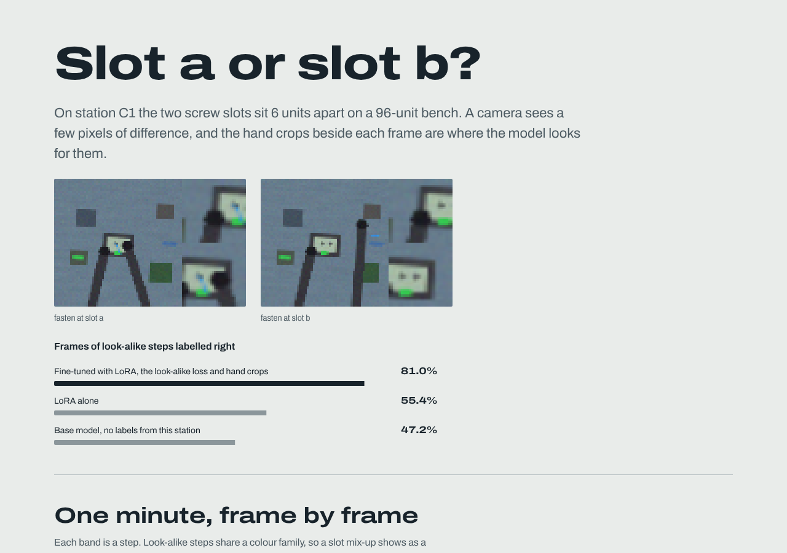
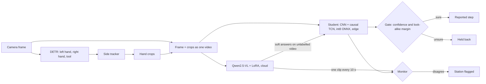

<!-- generated by python -m lsv.eval.cli readme from reports/; do not edit by hand -->
# lookalike-steps-vlm

A camera above an assembly station has to tell apart steps that look almost the same: a screw fastened at slot a or at slot b, a fastening or a torque check with a different tool, a clip inserted or removed. This repository fine-tunes a video-language model (the **Qwen2.5-VL** architecture from Hugging Face `transformers`) to recognise those steps on a new customer station from a few labelled recordings, distils it into a small model that runs on the camera box with **ONNX Runtime in int8**, and checks every answer before a customer sees it.

Four things make the difference on look-alike steps, and each is measured on its own:
1. **LoRA** fine-tuning on the customer station instead of a model that has never seen it;
2. a **look-alike loss** that trains the right step against the step it is confused with;
3. **hand crops** shown to the model beside the frame, cut around hands tracked by a **DETR-family detector** that tells the left hand from the right;
4. **distillation** to an edge student, with a gate that holds back unsure frames and a monitor that flags a station when the edge and the cloud model stop agreeing.

The stations and their video are simulated (`lsv/world`), so every frame has an exact truth. The product (`lsv/product`) never imports the world. No GPU and no pretrained weights were available where this was built: the Qwen2.5-VL model here is the real architecture scaled down to 1.1 M parameters and pretrained on 8 simulated stations. See [Limits](#limits).

## Dashboard

Customer station C1 (slot gap 6 px of a 96 px bench), 4 labelled recordings of 60 s, tested on 3 new recordings per condition.

| | Result |
|---|---|
| Look-alike steps right, cloud model | **81.0%** (LoRA alone 55.4%, base model without customer labels 47.2%) |
| All frames right, cloud model | **80.4%**, edit score 77.2, F1@50 80.8 |
| All frames right, edge model | **83.1%** (trained on the labels alone: 79.0%); agrees with the cloud model on 72.8% of frames |
| Frames the edge reports, and how many are right | **34.9%** reported, **93.5%** right |
| 'When did step X happen?' within 0.5 IoU | **84.8%** (mean IoU 0.70) |
| Hand identity F1 | **0.71** with left/right DETR, 0.14 with overlap tracking (0.0 vs 88.67 identity switches a minute) |
| Edge runtime per frame, one CPU thread | **3.86 ms** int8, 4.01 ms fp32; ONNX labels equal PyTorch's on 99.7% of frames |
| Weak recordings flagged by the monitor | **50.0%** of 12; healthy flagged 33.3% of 3 |
| LoRA parameters trained | 88,320 of 1,136,352 |
| Held-out station H1, run once | edge **80.6%** of frames right (F1@50 87.9); cloud 64.7%, look-alike 58.2% |



Gate on dev: **FAILED**. Held-out station H1, run once: **FAILED** on look-alike steps right, cloud model, frames right, edge model, reported frames right, edge model after its gate, frames the edge reports, hand identity f1, healthy recordings flagged by the monitor. See [docs/heldout.md](docs/heldout.md).

## Designs on the same recordings

| Design | Frames right | Look-alike right | Edit | F1@50 | When (R@0.5) | Trained parameters |
|---|---:|---:|---:|---:|---:|---:|
| `vlm_zero_shot` | 47.3% | 47.2% | 54.8 | 37.1 | 42.4% | 1,136,352 |
| `vlm_full` | 72.2% | 62.4% | 76.5 | 70.1 | 75.0% | 1,136,352 |
| `vlm_lora` | 68.3% | 55.4% | 72.8 | 65.3 | 72.8% | 88,320 |
| `vlm_lora_pairs` | 72.1% | 63.0% | 74.1 | 66.6 | 72.8% | 88,320 |
| **vlm_lora_pairs_crops** | **80.4%** | **81.0%** | **77.2** | **80.8** | **84.8%** | **88,320** |
| `scratch_student` | 79.0% | 82.7% | 81.2 | 74.9 | 77.2% | 495,131 |
| **edge_student** | **83.1%** | **83.5%** | **91.7** | **91.1** | **93.5%** | **495,131** |

- `vlm_zero_shot`: Base model, no labels from the customer station
- `vlm_full`: Full fine-tune on the labelled recordings
- `vlm_lora`: LoRA fine-tune
- `vlm_lora_pairs`: LoRA with the look-alike loss
- `vlm_lora_pairs_crops`: LoRA, look-alike loss and the tracked hand crops (the cloud model)
- `scratch_student`: Edge model trained on the labelled recordings only (no VLM)
- `edge_student`: Edge model distilled from the cloud model on unlabelled recordings (the product)

## Under other conditions

| Condition | Cloud: frames | Cloud: look-alike | Edge: frames | Edge reports | Reported right | Hand IDF1 |
|---|---:|---:|---:|---:|---:|---:|
| as recorded for training | 80.4% | 81.0% | 83.1% | 34.9% | 93.5% | 0.71 |
| camera moved (±22°, zoom, shift) | 33.0% | 30.3% | 54.3% | 14.3% | 63.6% | 0.41 |
| light and sensor noise | 69.9% | 70.3% | 78.7% | 53.7% | 91.0% | 0.68 |
| people walking past | 74.6% | 68.1% | 84.1% | 58.6% | 94.8% | 0.72 |
| a new product variant (slots moved, new housing colour) | 59.3% | 55.4% | 82.3% | 61.7% | 94.6% | 0.74 |

## Labelled recordings needed

| Labelled recordings | Frames right | Look-alike right |
|---:|---:|---:|
| 1 | 48.4% | 54.0% |
| 2 | 68.3% | 68.3% |
| 4 | 80.4% | 81.0% |

## The checks

The edge reports a frame only when its confidence is at least 0.87 and, when its two best guesses are a look-alike pair, the first beats the second by 0.0. Both limits are set on one validation recording to reach 95.0% there.

Every 10 seconds a camera sends one clip to the cloud model. On validation the edge and the cloud model disagree on 29.0% of frames, mostly at step boundaries; a station is flagged when they disagree on more than 44.0% of the last six clips, or when the edge reports fewer than 42.9% of frames over the last minute. A recording counts as weak when the edge gets fewer than 85% of its frames right (from the truth, which the monitor never sees).

| Recording | Edge frames right | Weak | Flagged | After | Why |
|---|---:|---|---|---:|---|
| C1/normal/13 | 73.7% | yes | yes | 50 s | the edge reports 12% of frames, under 43% |
| C1/normal/14 | 86.3% | no | yes | 50 s | the edge reports 33% of frames, under 43% |
| C1/normal/15 | 82.7% | yes | no |  |  |
| C1/camera/16 | 75.7% | yes | yes | 50 s | edge and cloud disagree on 83% of the last 6 clips |
| C1/camera/17 | 24.3% | yes | yes | 50 s | edge and cloud disagree on 83% of the last 6 clips |
| C1/camera/18 | 54.0% | yes | yes | 50 s | edge and cloud disagree on 67% of the last 6 clips |
| C1/lighting/19 | 72.0% | yes | no |  |  |
| C1/lighting/20 | 79.7% | yes | no |  |  |
| C1/lighting/21 | 77.3% | yes | no |  |  |
| C1/busy/22 | 78.3% | yes | yes | 50 s | edge and cloud disagree on 50% of the last 6 clips |
| C1/busy/23 | 86.3% | no | no |  |  |
| C1/busy/24 | 82.0% | yes | no |  |  |
| C1/variant/25 | 75.3% | yes | no |  |  |
| C1/variant/26 | 82.3% | yes | yes | 50 s | edge and cloud disagree on 50% of the last 6 clips |
| C1/variant/27 | 86.0% | no | no |  |  |

## The gate

Written in `config/gate.yaml` before the full run and not moved since.

| Line | Value | Limit | |
|---|---:|---:|---|
| Look-alike steps right, cloud model | 0.8099 | >= 0.9 | **fail** |
| Frames right, edge model | 0.8311 | >= 0.88 | **fail** |
| Reported frames right, edge model after its gate | 0.9351 | >= 0.95 | **fail** |
| Frames the edge reports | 0.3489 | >= 0.7 | **fail** |
| Hand identity F1 | 0.7069 | >= 0.8 | **fail** |
| Edge milliseconds per frame (int8, one thread) | 3.86 | <= 5.0 | pass |
| Weak recordings flagged by the monitor | 0.5 | >= 0.8 | **fail** |
| Healthy recordings flagged by the monitor | 0.3333 | <= 0.1 | **fail** |

**Where it falls short.** look-alike steps right, cloud model (0.81 against >= 0.9); frames right, edge model (0.831 against >= 0.88); reported frames right, edge model after its gate (0.935 against >= 0.95); frames the edge reports (0.349 against >= 0.7); hand identity f1 (0.707 against >= 0.8); weak recordings flagged by the monitor (0.5 against >= 0.8); healthy recordings flagged by the monitor (0.333 against <= 0.1). The look-alike accuracy and the edge accuracy are limited by a model about a thousandth of a released size trained on two CPU cores; most remaining errors sit within two frames of a step boundary. The hand tracker loses identity mainly through box precision on 6-pixel hands. The monitor separates a moved camera from a healthy station, but not an 83% recording from an 86% one. These are the next things to work on, in that order.

Held-out station H1 (slot gap 5, tools closer in colour, a longer standard work), run once with the settings dev ended on:

| Line | Value | Limit | |
|---|---:|---:|---|
| Look-alike steps right, cloud model | 0.582 | >= 0.9 | **fail** |
| Frames right, edge model | 0.8056 | >= 0.88 | **fail** |
| Reported frames right, edge model after its gate | 0.9349 | >= 0.95 | **fail** |
| Frames the edge reports | 0.3289 | >= 0.7 | **fail** |
| Hand identity F1 | 0.6578 | >= 0.8 | **fail** |
| Edge milliseconds per frame (int8, one thread) | 3.95 | <= 5.0 | pass |
| Weak recordings flagged by the monitor | 0.9286 | >= 0.8 | pass |
| Healthy recordings flagged by the monitor | 1 | <= 0.1 | **fail** |

## How it works



- **World** (`lsv/world/world.py`): stations with bins, a fixture, two screw slots a few pixels apart, a driver and a torque wrench, a clip tray; workers follow the standard work with skipped, swapped and paused steps; the camera moves, the light changes, people walk past, a product variant moves the slots.
- **Video-language model** (`lsv/product/vlm.py`): `Qwen2_5_VLForConditionalGeneration` built from a config, video patches built exactly as `Qwen2VLVideoProcessor` builds them (tested), a word-level tokenizer as a `PreTrainedTokenizerFast`. The answer is the next-token distribution over the steps of the station's standard work, so the model cannot name a step the station does not have.
- **Fine-tuning** (`lsv/product/train.py`): LoRA with PEFT on attention and MLP projections of both towers, merged after training; the look-alike loss; DistributedDataParallel ready (`lsv/product/ddp.py`), with a test that two ranks give the gradient of the whole batch.
- **Hands** (`lsv/product/detr.py`, `tracker.py`): a DETR with anchor-box queries refined layer by layer, Hungarian matching, every decoder layer supervised; the side tracker keeps identities by the detected side, with hysteresis.
- **Edge** (`lsv/product/student.py`, `export.py`, `edge.py`, `service.py`): distillation at temperature 2, ONNX export, static int8 quantisation of the encoder (QDQ, per channel), a runtime and an HTTP service with no PyTorch.

## Run it

```bash
pip install -r requirements.txt
python -m pytest -q
python -m lsv.eval.cli evaluate --profile quick   # the CI smoke run, about a minute
python -m lsv.eval.cli evaluate && python -m lsv.eval.cli gate && python -m lsv.eval.cli readme   # the full run
python -m lsv.eval.cli serve --port 8080         # POST /stations/{id}/frames on the exported models
cd web && npm ci && npm run dev                  # the dashboard
```

## Limits

- **Scale.** The model is the Qwen2.5-VL architecture at about a thousandth of the smallest released size, trained from scratch on simulated stations, on two CPU cores. The pipeline (patches, prompts, LoRA, the look-alike loss, distillation, export) does not depend on the size, but I have not run it on a released checkpoint such as Qwen2.5-VL-3B or InternVL, and I have not trained on more than one machine; the data-parallel path is tested with two CPU processes.
- **Video.** Frames are 64 × 64 and rendered; real factory video is larger, noisier and has steps this world does not make.
- **Edge hardware.** Latency is ONNX Runtime on one CPU thread of the build box, not a Jetson; TensorRT is not used.
- **The world decides what is hard.** The look-alike pairs were built to be hard in specific ways; real look-alike steps will be hard in others.
